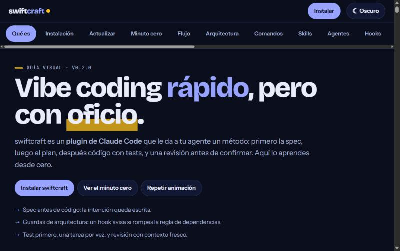

# swiftcraft — structured vibe-coding harness

<p align="center"></p>

A small Claude Code plugin that keeps vibe coding fast **and** organized: size-first workflow (ODD), architecture guardrails, test-first loop, written decisions, fresh-context review.

Stack-agnostic. Lean on purpose: 13 skills, 4 agents, 16 commands, 13 hooks, about 950 tokens of always-on context (`claude plugin details swiftcraft@swiftcraft`).



## Requirements

- [Claude Code](https://claude.com/claude-code) 2.x
- **Node.js 18 or newer** (`node --version`). The hooks and helper scripts are plain Node scripts that work on Windows, macOS and Linux. Without Node the hooks do not run (they fail without blocking you).
- Git. Optional: GitHub CLI (`gh`) for `/swiftcraft:pr-review`; Engram and RTK companions (`/swiftcraft:setup`).

## Install

From your terminal:

```
claude plugin marketplace add JefersonGuzman/swiftcraft
claude plugin install swiftcraft@swiftcraft
```

Or inside Claude Code: `/plugin marketplace add JefersonGuzman/swiftcraft` then `/plugin install swiftcraft@swiftcraft`. Restart Claude Code, type `/swiftcraft:` and you should see the command list.

Try it without installing: `claude --plugin-dir ./swiftcraft` (after `git clone https://github.com/JefersonGuzman/swiftcraft.git`).

## Updating

Inside Claude Code run `/swiftcraft:update`: it shows your version, the latest one, what changed (from this repo's `CHANGELOG.md`) and the two commands to run in a terminal:

```
claude plugin marketplace update swiftcraft
claude plugin update swiftcraft@swiftcraft
```

Restart Claude Code afterwards. The command never updates anything by itself. A short notice at session start (at most once every 24 h, 2.5 s timeout, silent when offline) tells you when a newer version exists; set `SWIFTCRAFT_NO_UPDATE_CHECK=1` to disable it. Only the public `plugin.json` and `CHANGELOG.md` of this repository are fetched; nothing about you or your project is sent. To hear about prereleases too, use the beta channel (`SWIFTCRAFT_CHANNEL=beta` or `updates.channel` in `swiftcraft.config.json`); prereleases are published as GitHub prereleases and the default channel never announces them.

If you installed with `--plugin-dir`, update by running `git pull` in the harness folder.

## Workflow

| Step | Command | Result |
|------|---------|--------|
| 0 | `/swiftcraft:init` | Project scaffold for a **new** project: constitution, architecture, ADRs, feature-document template |
| 0 | `/swiftcraft:adopt` | For a project that **already has code**: read-only analysis (observed facts vs inferences vs uncertainties), then draft documents in `docs/proposed/` for you to review; never overwrites or changes code |
| 1 | `/swiftcraft:odd <request>` | Runs the ODD protocol: stays read-only unless you ask for a change, explores, **sizes the work** (small = straight to a test, no paperwork; large = a feature document `odd/tasks/<feature>.md` with your exact words), then implements task by task |
| 2 | `/swiftcraft:build` | One task, RED → GREEN → REFACTOR, then stop, with a Risk line |
| 3 | `/swiftcraft:review` | Fresh-context diff review, verdict |
| — | `/swiftcraft:judge` | Optional adversarial review: two independent reviewers, merged by a script (no model) into coincident / discrepant / unconfirmed findings; costs about double, so it is shown first |
| 4 | `/swiftcraft:commit` | Plans reviewable commit units (a test travels with its code, sensitive areas alone, ~400 lines advisory), checks branch and Conventional Commit messages (no AI attribution), commits one unit at a time after you confirm |
| 5 | `/swiftcraft:pr` | Runs the project's own test/lint/build commands, drafts a PR description with task-to-commit traceability, real results and risk lines; pushes or opens the PR only after you confirm |
| — | `/swiftcraft:status` | Where the active feature stands: a state (`working`, `checking`, `ready`, `needs-decision`), the reason and the single next action, derived only from the feature document |
| — | `/swiftcraft:doctor` | Read-only diagnosis of the install and the project: `OK` / `WARNING` / `ERROR` with a fix for each; optional tools (gh, Claude CLI, Engram, RTK) only warn |
| — | `/swiftcraft:adr <topic>` | Decision record in `docs/adr/` |
| — | `/swiftcraft:remember <text>` | Save to project memory |
| — | `/swiftcraft:setup` | Check/install companions (Engram, RTK) |
| — | `/swiftcraft:export` | Generate Cursor / Gemini CLI / Copilot rules from AGENTS.md |
| — | `/swiftcraft:update` | Check for a newer version, see what changed, get the update commands |
| — | `/swiftcraft:pr-review <n\|url>` | Review a GitHub PR against your constitution, feature documents and architecture; posts comments only after you confirm |

## Output styles (optional)

Two styles ship with the plugin and none is on by default: `swiftcraft-lean` (result first, no preamble; full detail kept for errors, risks and confirmations) and `swiftcraft-explained` (a short *why* after each change). Pick one with `/output-style` (or the `outputStyle` setting). They change tone and length only: tests, permissions, hooks and the ODD protocol are unaffected.

## Configuration (optional)

Put a `swiftcraft.config.json` at the project root to tune low-stakes behavior. Precedence: defaults < project file < environment variables. `node scripts/config.js show` prints the effective values and where each one comes from; `/swiftcraft:doctor` validates the file.

```json
{
  "version": 1,
  "memory": { "nudge": true, "nudgeEdits": 3 },
  "review": { "reminder": true },
  "updates": { "check": true },
  "delivery": { "advisoryLines": 400 }
}
```

| Setting | Meaning | Environment override |
|---------|---------|----------------------|
| `memory.nudge` | Ask to save memory at the end of a session with edits | `SWIFTCRAFT_NO_NUDGE=1` |
| `memory.nudgeEdits` | Edits (1-100) before that reminder | `SWIFTCRAFT_NUDGE_EDITS` |
| `review.reminder` | Ask for `/swiftcraft:review` once per sensitive diff | `SWIFTCRAFT_NO_REVIEW_REMINDER=1` |
| `updates.check` | Notice of a newer release at session start | `SWIFTCRAFT_NO_UPDATE_CHECK=1` |
| `updates.channel` | `stable` (default) or `beta` (also announces prereleases) | `SWIFTCRAFT_CHANNEL=beta` |
| `delivery.advisoryLines` | Advisory size (50-5000) for a commit unit; never a cap | none |

Some controls are mandatory and **not configurable**: the command guard's deny rules and protected files. The file is rejected (with the reason) if it names them, has unknown keys, wrong types, or anything that looks like a secret; while it is rejected the defaults apply. Extra guard rules live in `docs/guard-rules.json`.

## What's inside

- **Skills**: `project-start`, `architecture-guard`, `odd`, `tdd-loop`, `adr`, `review-gate`, `context-hygiene`, `memory`, `token-saver`, `ui-design`, `pr-review`, `adopt`, `delivery`.
- **Agents**: `architect` (design), `reviewer` (diff review), `explorer` (compact code maps), `pr-reviewer` (PR findings as JSON). All read-only; `pr-reviewer` has no shell at all.
- **Hooks**
  - `SessionStart`: injects `docs/constitution.md`; shows the active feature document (progress, next task) and restores its open tasks after compaction.
  - `PreToolUse` protect-files: blocks writes to `.env`, keys and certificates.
  - `PreToolUse` command guard (Bash and PowerShell): blocks catastrophic commands and asks for confirmation on risky ones (see below).
  - `PostToolUse` `odd-lint`: validates a feature document whenever `odd/tasks/<feature>.md` is written (every task links a spec, every spec is covered, `L1` is the original request, ticked tasks record a commit or evidence) and feeds problems back.
  - `PostToolUse` `arch-lint`: flags framework/outer-layer imports inside `domain/` and `application/` (override with `docs/arch-rules.json`).
  - `SessionStart` update notice: at most once a day it compares your version with the one on GitHub and tells you if a newer one exists (opt out: `SWIFTCRAFT_NO_UPDATE_CHECK=1`).
  - `Stop` memory nudge: after 3+ file edits with nothing saved, asks once for `mem_save` + `mem_session_summary` (loop-safe; opt out with `SWIFTCRAFT_NO_NUDGE=1`, tune with `SWIFTCRAFT_NUDGE_EDITS`).
- **Stack templates** (`templates/stacks/`): Next.js, Node API, Python + FastAPI. `/swiftcraft:init` picks one.
- **Template** (`templates/project/`): `AGENTS.md`, `CLAUDE.md`, `docs/`, `odd/tasks/_template.md`, `.env.example`, `.gitignore`.

## ODD in one minute

1. **Authorize**: explain / review / propose requests stay read-only; only an explicit request changes files.
2. **Explore** the code in proportion to the request.
3. **Resolve uncertainty**: one focused question, only for a real decision.
4. **Classify**: *small* (understood, contained risk, resumable from the diff) needs no document; *large* does. Never sized by file count.
5. **Track**: large work gets `odd/tasks/<feature>.md` before the first edit: `## Specs` (`S#`, your words verbatim), `## Tasks` (`T#` linked to specs, route, commit), `## Log` (`L1` = your original request).
6. **Implement** one task at a time, tests first; delegate only for a named reason (mapping, parallel units, context, verification).
7. **Close** with the verified outcome, failed or skipped checks and a `Risk: none | item N` line; any named risk means `/swiftcraft:review` first.

Check a document yourself with `node scripts/odd.js check odd/tasks/<feature>.md`; resume with `/swiftcraft:status`.

## Memory (Engram)

The `memory` skill and `/swiftcraft:remember` use [Engram](https://github.com/Gentleman-Programming/engram) MCP tools when present (`mem_current_project`, `mem_save`, `mem_search`, `mem_context`, `mem_session_summary`) and fall back to `docs/memory/*.md` otherwise. The `SessionStart` hook reminds the agent of the protocol. Run `/swiftcraft:setup` to check the Engram binary and install its plugin (`node scripts/setup-engram.js --apply`); the binary itself is installed from Engram's docs.

## Other agents

- **Codex / OpenCode / Cursor / Gemini / Copilot** read `AGENTS.md` (open standard). `/swiftcraft:export` generates `.cursor/rules/swiftcraft.mdc`, `GEMINI.md` and `.github/copilot-instructions.md` from it.
- `.codex-plugin/plugin.json` exposes the same `skills/` to Codex. Skills are plain `SKILL.md` folders and can be copied to any agent that reads them.
- Hooks, slash commands and agents are Claude Code features. The Codex manifest and the Cursor/Gemini/Copilot exports were written from public docs and are **not yet tested** in those tools.

## Command guard

A `PreToolUse` hook inspects every shell command before it runs and answers with one of three outcomes:

| Outcome | Meaning | Examples |
|---------|---------|----------|
| **deny** | Blocked. It cannot be confirmed through the plugin; run it yourself in a terminal if you really mean it. | `rm -rf /`, `rm -rf ~`, deleting a drive or a system folder, `mkfs`, `dd of=/dev/sda`, fork bomb, force-push or delete of `main`/`master`, writing `.env` / `*.pem` / `id_rsa` through the shell |
| **ask** | Claude Code asks you to confirm. | recursive delete outside the project or with a target it cannot verify (`..`, `~`, variables, wildcards), `git reset --hard`, `git clean -f`, other force pushes, reading `.env` or private keys, `curl … \| sh`, `DROP TABLE`, `chmod -R 777`, `npm publish`, `gh repo delete` |
| *(silence)* | No opinion: the normal permission flow applies. Silence is **not** an approval. | everything else |

It understands quoting, `&&` / `;` / `|` chaining, `$(…)`, backticks, `bash -c`, `eval`, `sudo`/`xargs` wrappers and redirections. Simple relative deletes (`rm -rf node_modules`, `rm -rf dist`) and paths inside the project or the temp folder pass without a question.

**Project rules** (optional, `docs/guard-rules.json`): add your own `ask` / `deny` rules, relax `ask` rules by id (`disableAsk`) or by pattern (`allow`). `deny` rules can never be relaxed by a project.

```json
{
  "disableAsk": ["git-history-loss"],
  "allow": ["^rm -rf /var/cache/myapp$"],
  "ask": [{ "id": "deploy", "pattern": "^deploy\\b", "reason": "production deploy" }],
  "deny": [{ "id": "tf-destroy", "pattern": "terraform destroy", "reason": "never destroy infrastructure from the agent" }]
}
```

A local log (`swiftcraft-guard.log` in the temp folder, last 200 lines) keeps only the decision and the rule ids, never the command. `/swiftcraft:doctor` smoke-tests the guard and validates the rules file.

**Limits:** it is a static check of the command text. It does not expand variables, globs or aliases, so it has false negatives and false positives. It complements, and does not replace, Claude Code's permission rules or the operating system's controls.

## PR review

`/swiftcraft:pr-review 42` (or a PR URL) fetches the PR with the GitHub CLI (`gh auth status` must be OK), has the read-only `pr-reviewer` agent check it against `docs/constitution.md`, `docs/architecture.md`, the specs and ADRs, then shows a **dry run** of the review. Only after you confirm does it publish, as a single `COMMENT` review: findings on diff lines become inline comments, the rest go into the review body, secrets are redacted, and approving or requesting changes stays with you. PR text is treated as untrusted data. Every finding carries a `quote` of the source line it refers to; the publisher checks it against the diff, relocates a comment whose line number is wrong and moves anything it cannot verify into the review body. Tested end to end on a throwaway PR (the agent caught a hardcoded key, `eval`, an external script and a prompt-injection comment; the review was posted as `COMMENTED`). Scripts: `scripts/pr-fetch.js`, `scripts/pr-post.js` (dry run unless `--post`). `pr-fetch` leaves a scratch folder in the OS temp dir; remove it with `node scripts/cleanup.js --dir <folder> --apply`, or run `node scripts/cleanup.js` (a dry run) to see old leftovers. The cleanup only touches `swiftcraft-pr-<n>-<random>` folders and session state files older than 7 days, keeps anything recent, never follows symlinks and refuses any path outside the temp folder.

For fully automatic reviews on every PR you would add a CI workflow with Claude Code's GitHub Action; that needs an API key secret and is not included.

## Architecture it enforces

Feature-first Hexagonal: `src/<feature>/{domain,application,infrastructure,presentation}`, composition root in `src/app/`. Dependencies point inward only.

## Customize

- Edit `templates/project/` to change what new projects get.
- Add forbidden-import regexes in a project's `docs/arch-rules.json`:
  ```json
  { "domainForbidden": ["from\\s+['\"]my-orm"] }
  ```
- Trim or add skills under `skills/<name>/SKILL.md`.

## Design notes

Ideas borrowed in spirit from spec-driven development, ADRs, TDD, and fresh-context review harnesses, but kept small: a harness that loads hundreds of skills costs context on every session.

## Development

`npm test` (Node 18+). See [CONTRIBUTING.md](CONTRIBUTING.md) and [CHANGELOG.md](CHANGELOG.md).

## License

MIT

## Token savings

The `token-saver` skill ranks levers by impact: compress tool output (RTK) > read less > keep context small > shorter replies. `/swiftcraft:setup` detects RTK; `node scripts/setup-engram.js --apply --with-rtk` installs it on Windows (`winget install rtk-ai.rtk` + `rtk init -g`). RTK's hook only covers Bash calls, not the built-in Read/Grep/Glob.
